# cn-math-notation

**中国中小学数学写法库**：把课本上的竖式（以及将来的短除法、树状图、十字相乘、递等式）用几行文字写出来，渲染成和课本一样的图。作为 [KaTeX](https://katex.org) 的扩展使用：普通公式照常交给 KaTeX，本库只画 KaTeX 画不了的课堂写法。

<p align="center">
  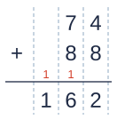
  &nbsp;&nbsp;
  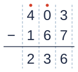
  &nbsp;&nbsp;
  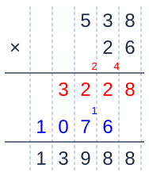
  &nbsp;&nbsp;
  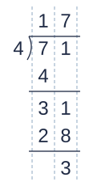
</p>

> **状态：早期版本。** 竖式支持整数与小数的加减、整数乘除；递等式支持整数四则运算与括号。两种写法：**语义式**只写算式、程序算出竖式；**直写布局**逐行写出，用来画孩子的错误过程或特殊写法。

## 为什么要做

- LaTeX、KaTeX、MathJax 都没有好用的竖式。MathML 虽然定义了竖式元素（`mstack`、`mlongdiv`），但浏览器不渲染，默认写法也是欧美习惯。
- 国内课本的写法有自己的规矩：加法进位写成小号数字、坐在横线上；退位在数字上方打点；乘法第二个部分积末位空着；除法是“除数在左、商在上”。
- 给孩子看的竖式还要能**标出错在哪一位**、能画出孩子自己写错的过程，而不只是标准答案。

## 写起来是这样

**语义式**：只写算式，进位、退位点、部分积、除法每一步都由程序算出。

```latex
$$\shushi{403-167}$$   $$\shushi{812\div4}$$   $$\shushi[multiCarry, colorByDigit]{538\times26}$$
```

<p>
  
  &nbsp;&nbsp;
  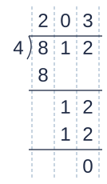
  &nbsp;&nbsp;
  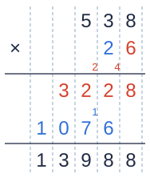
</p>

还可以写上孩子的答案，程序照孩子写的画出来，并标出错的位：`\shushi{403-167=346}`。这时默认不画进位、退位点等过程，免得被误当成孩子写的；要如实还原孩子的过程，用下面的直写布局。

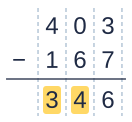

**直写布局**：逐行写出竖式，写什么画什么。

```latex
$$\shushi*{ 7 4 \\ + 8 8 \\ \jin{1 1 ~} \\ \hline 1 6 2 }$$
```


- 连续的数字自动一位一格，各行按个位对齐（有小数点时按小数点对齐）。
- 行首的 `+ - \times \div` 是运算符；`\\` 换行；`\hline` 画横线。
- `\jin{1 1 ~}` 是进位行，数字记在“进到的那一列”，`~` 是空格子。

完整写法见 **[使用说明](docs/usage.md)**。

## 递等式

只写算式，程序按课本的运算顺序一步步化简（有括号先算括号里，先乘除后加减），等号悬在算式左边：

```latex
$$\dengshi{[100-(20+30)]\div5}$$   $$\dengshi{20-5+3\times4}$$
```

<p>
  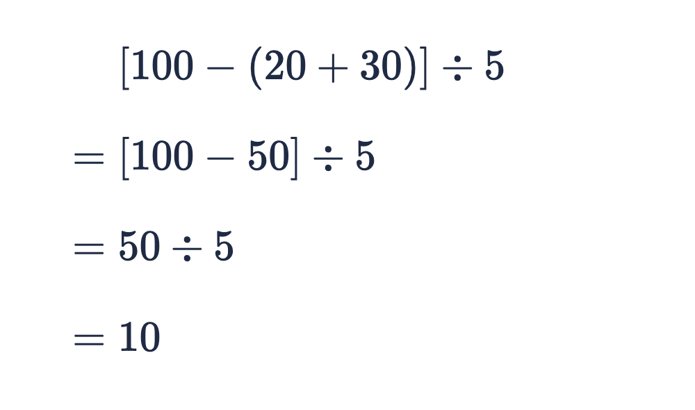
  &nbsp;&nbsp;
  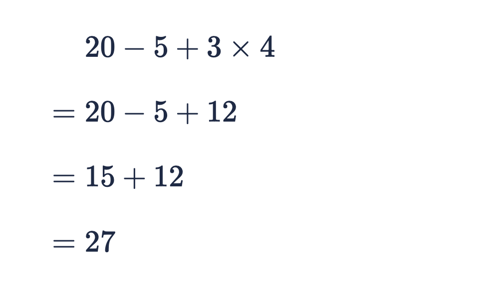
</p>

简便计算等需要自己安排步骤时，用 `\dengshi*{…}` 逐行写：`\dengshi*{25\times(40+4) \\ 25\times40+25\times4 \\ 1100}`。

## 更多直写布局例子

| 写法 | 效果 |
|---|---|
| 退位点：`\tui{40} 3 \\ - 1 6 7 \\ \hline 2 3 6` |  |
| 两位数乘两位数，第二行左移一位：<br>`4 3 \\ \times 3 7 \\ \hline 3 0 1 \\ 1 2 9 ~ \\ \hline 1 5 9 1` | 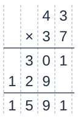 |
| 长除法：<br>`\shang 1 7 \\ \chu{4} 7 1 \\ 4 ~ \\ \hline 3 1 \\ 2 8 \\ \hline 3` |  |
| 小数补 0：`30.5\bu{0} \\ - 25.21 \\ \hline 5.29` | 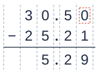 |
| 孩子写错的过程，标出错的位：<br>`\tui{4} 0 3 \\ - 1 6 7 \\ \hline \err{34} 6` | 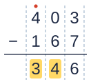 |

（表格里为了紧凑省略了外层的 `\shushi*{…}`。）

## 特性

- **一句算式出竖式**：加减（含小数、跨 0 退位、补 0）、乘（一位数简写或分步式、多位数部分积）、除（商中间有 0、有余数）都按课本步骤算出来。
- **课本写法为默认**：默认样式按沪教版课本核对过（进位正下、退位打点、数位虚线等），也能切换成其他习惯，例如进位写在左下：`\shushi*[carryAt=sw]{…}`。
- **能画错误过程**：`\err{}` 高亮出错的位，`\hong{}` 红色强调，`\hua{}` 划掉。渲染器不校验对错，写什么画什么。
- **拼音命令 + 英文别名**：`\shushi` / `\vertical`、`\jin` / `\carry`、`\tui` / `\borrow` 等完全等价。
- **SVG 输出、带朗读文字**：图是矢量的，随字号缩放；每个竖式附带一段文字描述（如“竖式：74，加 88，162”），供屏幕阅读器使用。
- **核心不依赖 KaTeX**：`@cn-math-notation/core` 可以单独使用，给其他编辑器写插件。

## 快速开始

```bash
npm install katex @cn-math-notation/katex
```

在自己的页面里接入 KaTeX：

```ts
import katex from "katex";
import "katex/dist/katex.min.css";
import { register } from "@cn-math-notation/katex";

register(katex); // 注册 \shushi、\shushi* 与英文别名 \vertical、\vertical*
katex.render(String.raw`\shushi{74+88}`, element, {
  displayMode: true,
});
```

不用 KaTeX、直接拿 SVG（`npm install @cn-math-notation/core`）：

```ts
import { renderShushi, renderShushiLayout } from "@cn-math-notation/core";

const { svg, label } = renderShushi("74+88"); // 语义式
const layout = renderShushiLayout(String.raw`7 4 \\ + 8 8 \\ \hline 1 6 2`); // 直写布局
```

## 在哪里能用

| 场景 | 能否显示 | 说明 |
|---|---|---|
| 自己的网页、应用（能控制 KaTeX 加载代码） | ✅ | 调用 `register(katex)` 即可 |
| 服务端渲染（`katex.renderToString`） | ✅ | 输出的 HTML 自带 SVG |
| Typora | ⏳ 计划中 | Typora 内置的是 MathJax，需要专门的 Typora 插件 |
| Obsidian、GitHub 等自带公式引擎的工具 | ❌ | 无法注册新命令；可以先用图片 |

## 路线图

| 期 | 内容 |
|---|---|
| 一（进行中） | 竖式直写布局 ✅、竖式语义式（整数与小数加减、整数乘除）✅、递等式（语义式与直写）✅、KaTeX 插件 ✅、试写页 ✅；MathML 导出 |
| 二 | 小数乘除、乘数末尾有 0 的简便写法、短除法、分解质因数树状图 |
| 三 | 十字相乘、多项式竖式、综合除法 |
| 之后 | Typora 插件 |

## 仓库结构

```
packages/core        模型、解析、SVG 渲染（不依赖 KaTeX）
packages/katex       KaTeX 插件（锁定 KaTeX ~0.19.1）
packages/playground  试写页
docs/usage.md        使用说明
docs/design/         设计草案与写法裁决记录
docs/images/         文档用的演示图（bun run docs:images 生成）
```

## 开发

需要 [Bun](https://bun.sh)。

```bash
git clone https://github.com/n7tequila/cn-math-notation.git
cd cn-math-notation
bun install
bun run build        # 编译两个包到 dist/
bun run check        # 类型检查 + 测试
bun run playground   # 试写页
bun run docs:images  # 重新生成文档图片
bun run demo         # 渲染全部例子到 out/demo.html
```

## 致谢

- [KaTeX](https://katex.org)：本库作为它的扩展运行。
- [MathML 小学算术（§3.6）](https://www.w3.org/TR/MathML3/chapter3.html)：内部模型借鉴了它的格子网、进位方位与划线设计。

## 许可

[MIT](LICENSE)
