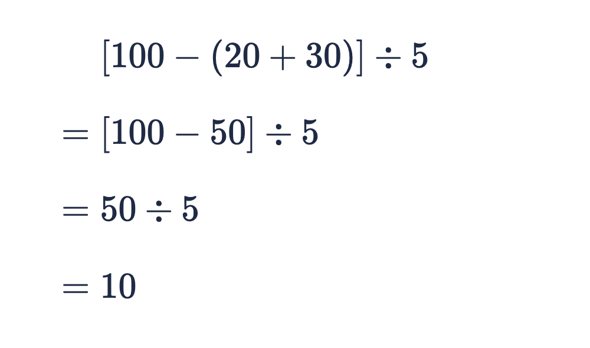
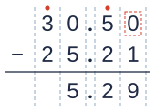
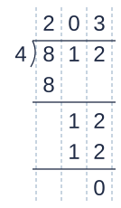
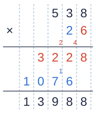
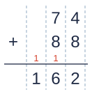
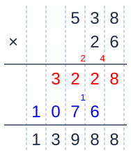
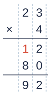
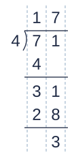
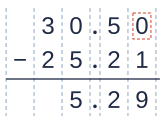

# 使用说明

第一期有两种写法：

- **语义式** `\shushi{403-167}`：只写算式，竖式过程由程序按课本步骤算出。日常出题、讲解用这个。
- **直写布局** `\shushi*{…}`：逐行写出竖式，写什么画什么。用来画孩子自己写错的过程，或语义式还不支持的写法。

两种写法共用同一套[样式选项](#样式选项)。

- [递等式](#递等式)
- [语义式](#语义式)
- [基本规则](#基本规则)
- [格子标记](#格子标记)
- [进位](#进位)
- [各类竖式](#各类竖式)
- [样式选项](#样式选项)
- [命令一览](#命令一览)
- [注意事项](#注意事项)
- [常见报错](#常见报错)
- [导出 MathML](#导出-mathml)
- [接入方式](#接入方式)

## 递等式

```latex
\dengshi{25\times(40+4)}          % 语义式：程序逐步化简
\dengshi*{25\times(40+4) \\ 25\times40+25\times4 \\ 1100}   % 直写：每行一步
```

排版：第一行不写等号，之后每行以等号开头，**等号悬在算式左边**，各行算式左端对齐。



语义式按课本的运算顺序，一步一行：

| 规则 | 例子 |
|---|---|
| 有括号先算括号里面的；小括号算完再算中括号 | `[100-(20+30)]÷5` → `[100-50]÷5` → `50÷5` → `10` |
| 括号外的运算等括号都算完再算 | `3×4+(5+6)` → `3×4+11` → `12+11` → `23` |
| 同一层先乘除、后加减；前面的加减也要等乘除算完 | `20-5+3×4` → `20-5+12` → `15+12` → `27` |
| 同级从左往右，一次一步 | `2×3×4+1` → `6×4+1` → `24+1` → `25` |
| 互不影响的几处在同一步里一起算 | `25×4+36÷6` → `100+6`；`(12+8)×(5-3)` → `20×2` |

- 运算符可以写 `+ - \times \div`（或 `× ÷ * /`），括号可以写 `( )`、`[ ]` 或全角括号。
- 只做整数：减法不能得负数，除法要能整除；小数属第二期。
- 语义式只按运算顺序算，不做简便计算（如 `25×(40+4)` 算成 `25×44`）。需要简便计算或特殊步骤时用直写 `\dengshi*`，行首写不写等号都可以，行里可以写分数等任何 KaTeX 公式。
- 英文别名：`\stepeq`、`\stepeq*`。
- 不用 KaTeX 时，`@cn-math-notation/core` 的 `buildDengshi("25×(40+4)")` 返回 TeX 字符串，可交给 MathJax 等任何 TeX 渲染器。

## 语义式（竖式）

```latex
\shushi{74+88}
\shushi{403-167}
\shushi{30.5-25.21}
\shushi{538\times26}
\shushi{812\div4}
```

运算符可以写 `+`、`-`（或 `−`）、`\times`（或 `×`、`*`）、`\div`（或 `÷`、`/`）。空格随意。

| 运算 | 支持范围 | 程序怎么画 |
|---|---|---|
| 加法 | 整数、小数 | 进位写成小字坐在横线上；小数按小数点对齐，位数不够时补 0（`padZero`）；结果末尾的 0 划掉（`strikeZero`） |
| 减法 | 整数、小数（结果不能为负） | 被借位的数字上方打退位点，跨 0 时每个被借过的位各一个点；被减数位数不够时补 0；结果末尾的 0 划掉 |
| 乘法 | 整数 | 一位数乘：简写（进位小字）或分步式（`mode=expanded`，课本只在两位数时用）；多位数乘：每个乘数位一行部分积、左移一位，乘数中间的 0 不写部分积；**因数末尾有 0**：0 前面的数对齐，0 甩在外面，积末尾再添 0（如 380×3） |
| 除法 | 整数（除数可以是多位数） | 商从第一个够除的位开始；每步写乘积、横线、余数并落下下一位；商中间有 0 时不写那一步的乘积；整除时最后写 0 |

<p>
  
  &nbsp;&nbsp;
  
  &nbsp;&nbsp;
  
</p>

小数乘除属第二期，暂时请用直写布局。

### 写上孩子的答案

在算式后面写 `=` 和孩子的答案，程序照孩子写的画出结果，并把和正确答案不同的位标为错误。

**写了孩子的答案时，默认不画计算过程**（进位、退位点、补的 0、乘法部分积、除法各步）：程序只能按正确算法画过程，画出来会被误当成孩子自己写的。要对照正确过程，加 `process=show`；要如实还原孩子写的整个过程，用直写布局。

- 按数位逐位对比：孩子的个位对正确答案的个位，十位对十位。
- **漏写的位**（如把 236 写成 36）：在缺的那一列补一个空格子并标错，看得出漏了哪一位。
- **多写的位**：超出正确答案范围的位标错。
- 兜底：答案的数值不对时，至少会有一位被标出来。

```latex
\shushi{403-167=346}
\shushi{71\div4=16……7}      % 余数也可以写成 16...7 或 16r7
```


想画出孩子完整的错误过程（比如退位点打错了），用直写布局 `\shushi*{…}`，按孩子实际写的逐行记下来。

### 用选项控制风格

```latex
\shushi[multiCarry, colorByDigit, carryAt=sw]{538\times26}
\shushi[mode=expanded]{23\times4}
\shushi[padZero=false]{2.5+1.25}
```

<p>
  
  &nbsp;&nbsp;
  
</p>

全部选项见[样式选项](#样式选项)。

## 基本规则

以下是直写布局的写法。

```latex
\shushi*{ 7 4 \\ + 8 8 \\ \hline 1 6 2 }
```

| 规则 | 说明 |
|---|---|
| `\\` 换行 | **分行只能用 `\\`**，直接回车不算换行（KaTeX 会把回车当空格）。为了好读，可以在 `\\` 后面再回车。 |
| 一位一格 | 连续的数字自动拆成一位一格：`74` 和 `7 4` 一样。空格可有可无。 |
| 按个位对齐 | 各行按最右一位（个位）对齐。只要有一行出现小数点，就改为按小数点对齐。 |
| 运算符 | 行首的 `+`、`-`、`\times`、`\div`（或 `×`、`÷`）是运算符，不占格子。只能写在一行开头。 |
| `\hline` | 在两行之间画横线，写在 `\\` 之后、下一行之前。 |
| `~` 空格子 | 占一格但不显示，用来让一行左移，例如乘法第二个部分积末位空着：`1 2 9 ~`。 |

多行写法（和上面等价）：

```latex
\shushi*{
     7 4 \\
  +  8 8 \\
  \hline
   1 6 2
}
```

## 格子标记

标记写在数字**前面**，作用于花括号里的数字。花括号里有一串数字时，每一位都加上标记：`\tui{40}` 等于 `\tui{4}\tui{0}`。

| 命令 | 英文别名 | 作用 | 画法 |
|---|---|---|---|
| `\tui{4}` | `\borrow{4}` | 退位点 | 数字正上方一个红点 |
| `\bu{0}` | `\pad{0}` | 补的 0 | 红色虚线框 |
| `\hong{1}` | `\hl{1}` | 教学强调 | 红色数字 |
| `\err{3}` | `\err{3}` | 标为错误 | 黄色底色高亮 |
| `\hua{3}` | `\strike{3}` | 划掉 | 一道斜线 |
| `\textcolor{blue}{…}` | — | 着色 | 用 KaTeX 原有命令，花括号里可以是数字，也可以是整个进位行 |

颜色只接受颜色名或 `#` 开头的色值（如 `red`、`#2f6fd6`）。

## 进位

进位单独写一行：`\jin{…}`（英文别名 `\carry{…}`）。里面的写法和普通行一样，按位对齐、空位用 `~`。**每个数字记在“进到的那一列”**。

```latex
\shushi*{ 7 4 \\ + 8 8 \\ \jin{1 1 ~} \\ \hline 1 6 2 }
```

个位 4+8 进 1 到十位，十位 7+8+1 进 1 到百位，所以进位行是 `1 1 ~`（百位 1、十位 1、个位空）。

进位画在哪里，取决于写在哪两行之间：

- 后面紧跟 `\hline`：坐在横线上（下标）。
- 否则：画在下一行的上方（上标）。多位乘法的第二组进位就是这样写的，见下文。

水平位置由 `carryAt` 选项决定：

| `carryAt=s`（默认，课本写法） | `carryAt=sw`（左下） |
|---|---|
|  |  |
| 写在进到的那一列正下方 | 写在产生进位那一位的左下方（贴着两列分界） |

## 各类竖式

### 加法、减法

```latex
\shushi*{ \tui{40} 3 \\ - 1 6 7 \\ \hline 2 3 6 }
```


被减数中间有 0 时，被借过的每一位各打一个点，0 上方不另写 9。

### 乘法

两位数乘两位数：第二个部分积用 `~` 左移一位，末位空着。课本默认不写进位。

```latex
\shushi*[operatorPlacement=adjacent]{
      4 3 \\
  \times 3 7 \\ \hline
    3 0 1 \\
  1 2 9 ~ \\ \hline
  1 5 9 1
}
```


需要写进位时，第一组进位坐在乘数下方的横线上，之后每组写在各自部分积的上方。可以用 `\textcolor` 让乘数的每一位和它的进位、部分积同色：

```latex
\shushi*[carryAt=sw]{
       5 3 8 \\
  \times  2 6 \\
  \textcolor{red}{\jin{2 4 ~}} \\ \hline
  \textcolor{red}{3 2 2 8} \\
  \textcolor{blue}{\jin{1 ~ ~}} \\
  \textcolor{blue}{1 0 7 6 ~} \\ \hline
  1 3 9 8 8
}
```



一位数乘法有简写和分步式两种写法：

| 简写 | 分步式 |
|---|---|
| `2 3 \\ \times 4 \\ \jin{1 ~} \\ \hline 9 2` | `2 3 \\ \times 4 \\ \hline \hong{1} 2 \\ 8 0 \\ \hline 9 2` |
|  |  |

### 除法

商行用 `\shang` 开头，被除数行用 `\chu{除数}` 开头（自动画括号和顶线），其余每一步照常写。各行按被除数的个位对齐，所以 `4 ~` 让 4 落在十位下面。

```latex
\shushi*{
  \shang 1 7 \\
  \chu{4} 7 1 \\
  4 ~ \\ \hline
  3 1 \\
  2 8 \\ \hline
  3
}
```



### 小数

有小数点时按小数点对齐，小数点单独占一条窄列。位数不够时用 `\bu{0}` 补 0。

```latex
\shushi*[operatorPlacement=adjacent]{ 30.5\bu{0} \\ - 25.21 \\ \hline 5.29 }
```



### 孩子写错的过程

照孩子实际写的记，用 `\err{}` 标出错的位（这里孩子写成 346，正确是 236，百位和十位错了）。渲染器不校验对错。

```latex
\shushi*{ \tui{4} 0 3 \\ - 1 6 7 \\ \hline \err{34} 6 }
```


## 样式选项

写在命令后的方括号里，多个选项用逗号分隔；只写名字表示 `true`：

```latex
\shushi*[carryAt=sw, guides=false]{ … }
```

| 选项 | 取值 | 默认 | 作用 |
|---|---|---|---|
| `carryAt` | `s` / `sw` | `s` | 进位写在正下方 / 左下方 |
| `guides` | `true` / `false` | `true` | 数位虚线 |
| `operatorPlacement` | `far` / `adjacent` | `far` | 运算符放最左 / 紧挨数字 |
| `multiCarry` | `true` / `false` | `false` | 多位乘法是否画进位（语义式；直写布局写了 `\jin` 就画） |
| `padZero` | `true` / `false` | `true` | 小数位数不够时补 0，补的 0 加虚线框（语义式） |
| `colorByDigit` | `true` / `false` | `false` | 按乘数位着色，乘数每一位与它的进位、部分积同色（语义式） |
| `mode` | `compact` / `expanded` | `compact` | 一位数乘法：简写 / 分步式（语义式） |
| `strikeZero` | `true` / `false` | `true` | 小数结果末尾的 0 划掉，小数点不划（语义式；孩子写的答案不划） |
| `process` | `auto` / `show` / `hide` | `auto` | 是否画计算过程（语义式）。`auto`：写了孩子答案就不画；`show`：总是画；`hide`：总是不画（出题时只给题目和横线可配合使用） |

接入时也可以统一改默认值，方括号里的选项仍然优先：

```ts
register(katex, { defaults: { carryAt: "sw" } });
```

## 命令一览

| 拼音（主） | 英文别名 | 用途 |
|---|---|---|
| `\shushi*[选项]{…}` | `\vertical*` | 竖式（直写布局） |
| `\shushi[选项]{算式}` | `\vertical` | 竖式（语义式，程序算出过程） |
| `\dengshi{算式}` | `\stepeq` | 递等式（语义式，按运算顺序逐步化简） |
| `\dengshi*{… \\ …}` | `\stepeq*` | 递等式（直写，每行一步） |
| `\jin{…}` | `\carry{…}` | 进位行 |
| `\tui{…}` | `\borrow{…}` | 退位点 |
| `\bu{…}` | `\pad{…}` | 补 0 |
| `\hong{…}` | `\hl{…}` | 红色强调 |
| `\err{…}` | — | 标为错误 |
| `\hua{…}` | `\strike{…}` | 划掉 |
| `\shang` | — | 长除法商行 |
| `\chu{除数}` | — | 长除法被除数行 |

## 注意事项

- **花括号里不能写 `%` 注释**：KaTeX 把它当普通字符交给本库，会报“不认识的字符”。
- **宏会被展开**：KaTeX 会先展开花括号里的宏。`~` 本身就是这样被展开成 `\nobreakspace` 的，本库已经处理；如果你自定义了和本库命令同名的宏（如 `\jin`），会被你的宏替换掉。
- **多字符的格子**（如初中多项式竖式里的 `3x^2`）属于第三期，写 `&` 会提示“暂不支持”。
- 本库依赖 KaTeX 的内部扩展接口，目前锁定在 KaTeX `~0.19.1`。

## 常见报错

| 报错 | 原因 |
|---|---|
| 运算符 + 只能写在一行的开头 | 运算符写在了数字中间，比如 `7 + 4`。 |
| \hline 要单独放在两行之间 | `\hline` 写在了一行末尾，比如 `7 4 \hline`。应写成 `7 4 \\ \hline`。 |
| 花括号没有配对 | 少了 `}`。 |
| 不认识的命令 \xxx | 命令名写错了，或用了还不支持的命令。 |
| 一行里出现了两个小数点 | 比如 `1.2.3`。 |
| 进位行（\jin）里不能有运算符 | 进位行里只能有数字和 `~`。 |
| 竖式里至少要有一行数字 | 只写了横线或进位行。 |
| 这里应该是数字 / 运算符 | 语义式的算式写错了，比如 `\shushi{7+}`，或把直写布局的内容写进了 `\shushi{…}`（直写布局要加星号 `\shushi*`）。 |
| 被减数比减数小 | 语义式减法不处理负数结果。 |
| 小数乘法 / 小数除法属第二期 | 暂时用直写布局。 |
| 除数不能是 0 | — |
| 除不尽，递等式里的除法要能整除 | 递等式只做整数，除法要能整除。 |
| 得负数，小学递等式不处理负数 | 减法的被减数比减数小。 |
| 小括号 / 中括号没有配对、多了一个右括号 | 括号写错了。 |

在 KaTeX 里，这些报错和 KaTeX 自己的语法错误一样处理：`throwOnError: false` 时显示为红色错误文字，不会让页面崩掉。

## 导出 MathML

竖式可以导出成标准 MathML（MathML 3 §3.6 小学算术：`mstack`、`mlongdiv`、`mscarries`、`msline`），方便放进其他支持 MathML 的工具。

```ts
import { shushiToMathML, shushiLayoutToMathML } from "@cn-math-notation/core";

shushiToMathML("403-167");                 // 语义式
shushiLayoutToMathML(String.raw`7 4 \\ + 8 8 \\ \hline 1 6 2`);  // 直写布局
shushiToMathML("74+88", "carryAt=sw", undefined, { carries: "above", wrap: false, display: "inline" });
```

| 竖式里的东西 | MathML |
|---|---|
| 加减乘竖式 | `<mstack stackalign="right">`，每行 `<msrow>`，运算符是行首的 `<mo>` |
| 除法 | `<mlongdiv longdivstyle="lefttop">`（除数在左、商在上） |
| 横线 | `<msline/>` |
| 进位、退位点 | 该行前面的 `<mscarries>`。坐在横线上的进位（课本写法）用 `location="s"` 挂在上一行，没有进位的格子放透明占位（`aria-hidden`）；写在下一行上方的进位、退位点用 `location="n"`，退位点内容是“·” |
| 补的 0 / 划掉的 0 | `<menclose notation="box">` / `<menclose notation="updiagonalstrike">` |
| 错误位、着色 | `mathbackground` / `mathcolor` |
| 数位虚线 | 无对应写法，省略 |
| 朗读文字 | `<math alttext="…">` |

选项（第四个参数）：

| 选项 | 取值 | 默认 | 说明 |
|---|---|---|---|
| `wrap` | `true` / `false` | `true` | 外面包不包 `<math>` |
| `display` | `block` / `inline` | `block` | `<math display>` |
| `carries` | `textbook` / `above` | `textbook` | 进位写法。`textbook`：按课本，坐在横线上的进位画在上一行下方（`location="s"`）；`above`：一律写在进到的那一行上方（`location="n"`，MathML 的默认写法）。 |

**兼容性**：主流浏览器不原生渲染 `mstack` / `mlongdiv`（它们不在 MathML Core 里）。用 W3C 官方 polyfill（elem-math）实测，两种写法的 30 个例子位置都正确。为适配 polyfill 做了三处处理：只用 `s` 和 `n` 两种方位（`se`、`ne` 会错位，左下进位写法在 MathML 里不区分）；坐在横线上的进位铺满整行透明占位（polyfill 用每格的下边框拼横线，带进位的格子会变高，不铺满横线就断成几截）；占位用与真进位同结构的透明数字（`mphantom` 会矮约 1px）。处理后横线下各格高度差 < 0.5px；进位下沿略压横线，是 polyfill 的进位样式（60% 字号、90% 行高）所致。运行 `bun run mathml:preview` 可生成对照页 `out/mathml-preview.html`。

在 KaTeX 里，竖式输出中隐藏的 MathML 默认就是上面的 `mstack` 结构（供复制、辅助技术使用）；`register(katex, { mathml: "label" })` 改为只放朗读文字，`register(katex, { mathmlCarries: "above" })` 让进位写在上方。试写页每个竖式下方有“复制 MathML”按钮。

## 接入方式

### 网页里用 KaTeX

```ts
import katex from "katex";
import "katex/dist/katex.min.css";
import { register } from "@cn-math-notation/katex";

register(katex);
katex.render(String.raw`\shushi*{ 7 4 \\ + 8 8 \\ \hline 1 6 2 }`, element, { displayMode: true });
```

普通公式和竖式可以写在同一个公式里：`74+88=162 \quad \shushi*{…}`。

### 服务端渲染

`katex.renderToString(...)` 的输出里已经包含竖式的 SVG，页面上只需要引入 KaTeX 的 CSS。

### 不用 KaTeX

```ts
import { renderShushiLayout } from "@cn-math-notation/core";

const { svg, label, widthEm, heightEm } = renderShushiLayout(String.raw`7 4 \\ + 8 8 \\ \hline 1 6 2`);
```

- `svg`：SVG 字符串，颜色跟随外层文字颜色（`currentColor`），尺寸以 `em` 计、随字号缩放。
- `label`：朗读用的文字描述。
- 嵌进别的排版盒子时，传 `{ display: "block" }` 作为第四个参数，避免基线错位撑出空白。

### Typora、Obsidian、GitHub

这些工具自带公式引擎，无法注册新命令，`\shushi*` 会显示为错误。Typora 插件在计划中；在此之前可以用图片（例如本仓库 `docs/images/` 里的图）。
