# 使用说明

第一期有两种写法：

- **语义式** `\shushi{403-167}`：只写算式，竖式过程由程序按课本步骤算出。日常出题、讲解用这个。
- **直写布局** `\shushi*{…}`：逐行写出竖式，写什么画什么。用来画孩子自己写错的过程，或语义式还不支持的写法。

两种写法共用同一套[样式选项](#样式选项)。

- [递等式](#递等式)
- [语义式](#语义式)
- [基本规则](#基本规则)
- [格子标记](#格子标记)
- [进位](#进位)
- [各类竖式](#各类竖式)
- [样式选项](#样式选项)
- [命令一览](#命令一览)
- [注意事项](#注意事项)
- [常见报错](#常见报错)
- [导出 MathML](#导出-mathml)
- [接入方式](#接入方式)

## 递等式

```latex
\dengshi{25\times(40+4)}          % 语义式：程序逐步化简
\dengshi*{25\times(40+4) \\ 25\times40+25\times4 \\ 1100}   % 直写：每行一步
```

排版：第一行不写等号，之后每行以等号开头，**等号悬在算式左边**，各行算式左端对齐。


语义式按课本的运算顺序，一步一行：

| 规则 | 例子 |
|---|---|
| 有括号先算括号里面的；小括号算完再算中括号 | `[100-(20+30)]÷5` → `[100-50]÷5` → `50÷5` → `10` |
| 括号外的运算等括号都算完再算 | `3×4+(5+6)` → `3×4+11` → `12+11` → `23` |
| 同一层先乘除、后加减；前面的加减也要等乘除算完 | `20-5+3×4` → `20-5+12` → `15+12` → `27` |
| 同级从左往右，一次一步 | `2×3×4+1` → `6×4+1` → `24+1` → `25` |
| 互不影响的几处在同一步里一起算 | `25×4+36÷6` → `100+6`；`(12+8)×(5-3)` → `20×2` |

- 运算符可以写 `+ - \times \div`（或 `× ÷ * /`），括号可以写 `( )`、`[ ]` 或全角括号。
- 整数、小数都可以，按精确的十进制算（`0.1+0.2` 得 `0.3`）。题目里写的数照原样写回（`3.50` 仍写 `3.50`），算出来的数去掉末尾的 0（`0.5×0.4` 得 `0.2`）。
- 除法要能除尽（`1÷8` 得 `0.125`）；除不尽（如 `1÷3`）时报错，要写近似值或循环小数请用直写 `\dengshi*`。
- 负数默认可以用（初中有理数混合运算）：负号写在算式开头或紧跟左括号，如 `(-3)\times2+5`、`5-(-2)`；写在运算符后面要加括号（`5\times-2` 会报错）。算出来的负数前面是运算符时加括号（`2×(3-5)` → `2×(-2)`），在开头时不加（`-4-(-4)`）。小学的题想防止误写出负数，加 `negative=false`，得负数时报错。
- 语义式只按运算顺序算，不做简便计算（如 `25×(40+4)` 算成 `25×44`）。需要简便计算或特殊步骤时用直写 `\dengshi*`，行首写不写等号都可以，行里可以写分数等任何 KaTeX 公式。
- 英文别名：`\stepeq`、`\stepeq*`。
- 不用 KaTeX 时，`@cn-math-notation/core` 的 `buildDengshi("25×(40+4)")` 返回 TeX 字符串，可交给 MathJax 等任何 TeX 渲染器；选项作第二个参数传入，如 `buildDengshi("2×3×4+1", "steps=1")`。

### 只写前几步

方括号里写 `steps=N`，只写出前 N 步（不算题目那行），适合出练习、让孩子接着写。没写出来的步骤默认每步留一个空等号行（`rest=blank`），行数和完整递等式一样；`rest=cut` 时直接截断。语义式、直写都能用。

```latex
\dengshi[steps=1]{2\times3\times4+1}            % 2×3×4+1 / =6×4+1 / =____ / =____
\dengshi[steps=1, rest=cut]{2\times3\times4+1}  % 2×3×4+1 / =6×4+1
\dengshi[steps=0]{25\times(40+4)}               % 只写题目，后面两行留空
```

| 选项 | 取值 | 默认 | 作用 |
|---|---|---|---|
| `steps` | 不小于 0 的整数 | 全部写出 | 写出几步（不算题目那行）；不少于总步数时照常写完 |
| `rest` | `blank` / `cut` | `blank` | 没写出来的步骤：留空等号行 / 直接截断 |
| `negative` | `true` / `false` | `true` | `false` 时不允许负数：写了负数或算出负数都报错（只对语义式起作用） |

## 短除法

```latex
\duanchu{36}                 % 分解质因数
\duanchu[result]{36, 48}     % 两个数：除到互质；result 在下面写出最大公因数、最小公倍数
\duanchu[result]{4, 6, 9}    % 三个数（求最小公倍数）
\duanchu*{2 | 36 48 \\ 2 | \err{17} 24 \\ 3 4}   % 直写：逐行写，可标出写错的数
```

<p>
  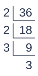
  &nbsp;&nbsp;
  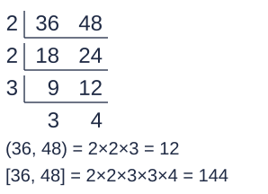
  &nbsp;&nbsp;
  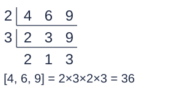
</p>

画法：除数在左，竖线隔开，每一行的数下面一条横线，最后一行写商；每个数整个占一格，各列按个位对齐。课本里还没核到样本，按常见写法画【推论】。

| 写法 | 程序怎么除 |
|---|---|
| 一个数 | 分解质因数：从小到大用质数去除，除到商是质数为止 |
| 两个数 | 用公有的质因数从小到大去除，除到两个商互质 |
| 三个数 | 求最小公倍数的写法：用能整除其中至少两个数的最小质数去除，除不尽的数原样落下，除到两两互质 |

- 数之间用逗号、顿号或空格分开，最多三个数；质数、互质的几个数不用列短除法，会报错。
- `result`（默认关）：一个数写 `36 = 2×2×3×3`；两个数写 `(36, 48) = 2×2×3 = 12` 和 `[36, 48] = 2×2×3×3×4 = 144`；三个数只写最小公倍数，乘积里的 1 省略。圆括号表示最大公因数、方括号表示最小公倍数【推论】。
- 想先除以 6 这类合数，或画孩子自己的写法，用直写 `\duanchu*`：行用 `\\` 分开，`|` 左边是除数，右边是这一行的数，最后一行只写商；`\err{…}`、`\hong{…}` 包住整个数。直写不支持 `result`。
- 英文别名：`\shortdiv`、`\shortdiv*`。MathML 表达不了短除法，导出时只给朗读文字。

## 树状图（分解质因数）

```latex
\shuzhuang{36}                       % 每步拆出最小的质数（与短除法步骤对应）
\shuzhuang[split=half, result]{36}   % 尽量对半拆；result 在下面写 36 = 2×2×3×3
\shuzhuang*{36 = 4 \times 9 \\ 4 = 2 \times 2 \\ 9 = 3 \times 3}   % 直写：孩子自己的拆法
```

<p>
  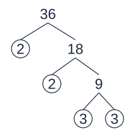
  &nbsp;&nbsp;
  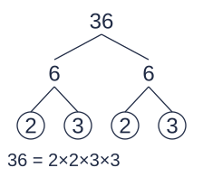
  &nbsp;&nbsp;
  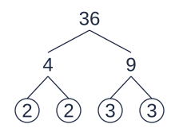
</p>

画法：拆开的数下面连两条斜线到两个因数，质数画圈；叶子从左到右排开，拆开的数居中在它的因数上方。课本里还没核到样本，按常见写法画【推论】。

| 选项 | 取值 | 默认 | 作用 |
|---|---|---|---|
| `split` | `prime` / `half` | `prime` | 语义式的拆法：每步拆出最小质数（质数在左、另一边继续拆）/ 每步拆成最接近的两个因数 |
| `circle` | `true` / `false` | `true` | 质数叶子画圈 |
| `result` | `true` / `false` | `false` | 下面写出结果算式，因数从小到大 |

- 直写 `\shuzhuang*`：每条写一次拆分 `数 = 因数 \times 因数`（也可写 `×`、`*`），用 `\\` 分开；第一条的左边是最上面的数；有几个相同的数时先拆最左边还没拆的那个；没写拆法的数就是叶子。
- 直写照写的画，不检查拆得对不对；只有真是质数的叶子才画圈，没拆完的合数不画圈。写错的数可以用 `\err{…}`、`\hong{…}` 包起来。直写能用 `circle`、`result`，不能用 `split`。
- 英文别名：`\factortree`、`\factortree*`。MathML 表达不了树状图，导出时只给朗读文字。

## 十字相乘

```latex
\shizi{x^2+5x+6}                 % 二次项系数为 1
\shizi[result]{6x^2-7x-3}        % 二次项系数不为 1；result 在下面写出分解结果
\shizi{x^2+5xy+6y^2}             % 两个字母
\shizi*{x & +2 \\ x & \err{-3} \\ 3x-2x=x}   % 直写：两行四个角，可加第三行验算
```

<p>
  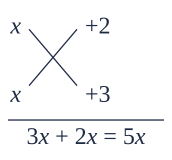
  &nbsp;&nbsp;
  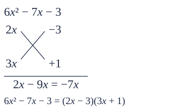
</p>

画法：左列写二次项拆成的两项，右列写常数项（或 y² 项）拆成的两项，正负号都写；两条斜线交叉（左上连右下、左下连右上）；横线下写验算行，先写左上乘右下、再写左下乘右上，如 `3x + 2x = 5x`。课本里还没核到样本，按常见写法画【推论】。

| 选项 | 取值 | 默认 | 作用 |
|---|---|---|---|
| `problem` | `true` / `false` | `true` | 在上方写出原题，如 `x² + 5x + 6`（直写没有原题） |
| `check` | `true` / `false` | `true` | 写验算行 |
| `result` | `true` / `false` | `false` | 下面写出分解结果，如 `x² + 5x + 6 = (x + 2)(x + 3)` |

- 支持整系数的 `ax² + bx + c` 与 `ax² + bxy + cy²`，平方写 `x^2`、`x^{2}` 或 `x²`。几种拆法都行时，取左边二次项系数的因数从小到大、右边常数按绝对值从小到大（正的在前）找到的第一组【推论】。
- 报错：在整数范围内分解不了；有公因式（请先提出公因式）；二次项系数是负数（请先提出负号）；没有常数项。
- 直写 `\shizi*`：两行，每行用 `&` 分成左右两项；可加第三行写验算；`\err{…}`、`\hong{…}` 包住一个角或验算行。整张图画成 SVG，所以每个角只能写简单的单项式（数字、字母、`^` 次数、正负号），不能写分数等任意公式。直写不接受选项。
- 英文别名：`\crossmul`、`\crossmul*`。MathML 表达不了交叉线，导出时只给朗读文字。

## 综合除法

```latex
\zonghe{(x^2+3x+2)\div(x+1)}             % 除以 x − a：根写在左边，最后一格是余数
\zonghe[result]{(2x^3-3x+5)\div(x-2)}    % result 在下面写出商与余数
\zonghe*{-1 | 1 & 3 & 2 \\ & -1 & -2 \\ 1 & \err{4} & 0}   % 直写：三行，可标出算错的格
```

<p>
  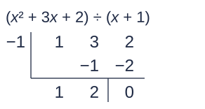
  &nbsp;&nbsp;
  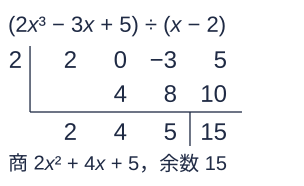
</p>

画法（设计草案 §5.8）：除式 x − a 的根 a 写在左边，竖线贯穿前两行；第一行是被除式各项系数（缺项写 0），第二行是乘积（第一格空着），横线下是结果；最后一格前一条短竖线隔出余数。课本里还没核到样本【推论】。

- 只做除以 `x − a`（一次项系数为 1）；`2x − 1` 这类除式报错。算式写法与多项式长除法相同。
- `problem`（默认开）：在上方写出原题，如 `(x² + 3x + 2) ÷ (x + 1)`；`problem=false` 不写。直写没有原题。
- `result`（默认关）：写出“商 2x² + 4x + 5，余数 15”。
- 直写 `\zonghe*`：三行用 `\\` 分开，每行各格用 `&` 分开；第一行“根 | 各项系数”，第二行第一格空着，三行格数相同；每格写一个整数，可用 `\err{…}`、`\hong{…}` 包起来。直写不接受选项。
- 英文别名：`\synthdiv`、`\synthdiv*`。MathML 表达不了，导出时只给朗读文字。

## 语义式（竖式）

```latex
\shushi{74+88}
\shushi{403-167}
\shushi{30.5-25.21}
\shushi{538\times26}
\shushi{812\div4}
```

运算符可以写 `+`、`-`（或 `−`）、`\times`（或 `×`、`*`）、`\div`（或 `÷`、`/`）。空格随意。

| 运算 | 支持范围 | 程序怎么画 |
|---|---|---|
| 加法 | 整数、小数 | 进位写成小字坐在横线上；小数按小数点对齐，位数不够时补 0（`padZero`）；结果末尾的 0 划掉（`strikeZero`） |
| 减法 | 整数、小数（结果不能为负） | 被借位的数字上方打退位点，跨 0 时每个被借过的位各一个点；被减数位数不够时补 0；结果末尾的 0 划掉 |
| 乘法 | 整数、小数 | 一位数乘：简写（进位小字，`carry=false` 可关）或分步式（`mode=expanded`，课本只在两位数时用）；多位数乘：每个乘数位一行部分积、左移一位，乘数中间的 0 不写部分积；**因数末尾有 0**：0 前面的数对齐，0 甩在外面，积末尾再添 0（如 380×3、4.2×20）；小数因数末尾的 0 也甩在外面，积按原来的小数位数点小数点（3.50×12 按 35×12 算，积写 42.00，末尾的 0 划掉）；**小数**：两个因数末位对齐、按整数乘，部分积不点小数点，积的小数点写在两个数字中间（不占一列），位数不够时前面补 0（0.12×0.3=0.036），积末尾的 0 划掉；小数因数末尾有 0（3.50）暂不支持 |
| 除法 | 整数、小数（除数可以是多位数、小数） | 商从第一个够除的位开始；每步写乘积、横线、余数并落下下一位；商中间有 0 时不写那一步的乘积；整除时最后写 0。**除不尽时默认添 0 除成小数**（12÷50 写成 12.0、商 0.24），要写余数加 `remainder`，孩子的答案写了余数时自动按余数画；商的小数点与被除数的小数点对齐，添的 0 写在余数行；**除数是小数**：除数、被除数原来的小数点划掉，按新小数点除；商是循环小数暂不支持 |

<p>
  
  &nbsp;&nbsp;
  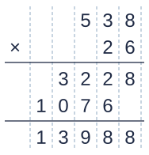
  &nbsp;&nbsp;
  
</p>

<p>
  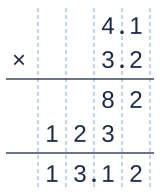
  &nbsp;&nbsp;
  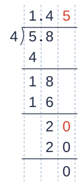
  &nbsp;&nbsp;
  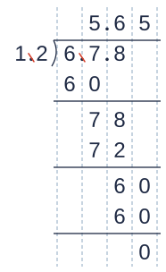
</p>

直写布局按小数点对齐各行，适合加减法；小数乘除（末位对齐）请用语义式。

### 写上孩子的答案

在算式后面写 `=` 和孩子的答案，程序照孩子写的画出结果，并把和正确答案不同的位标为错误。

**写了孩子的答案时，默认不画计算过程**（进位、退位点、补的 0、乘法部分积、除法各步）：程序只能按正确算法画过程，画出来会被误当成孩子自己写的。要对照正确过程，加 `process=show`；要如实还原孩子写的整个过程，用直写布局。

- 按数位逐位对比：孩子的个位对正确答案的个位，十位对十位。
- **漏写的位**（如把 236 写成 36）：在缺的那一列补一个空格子并标错，看得出漏了哪一位。
- **多写的位**：超出正确答案范围的位标错。
- 兜底：答案的数值不对时，至少会有一位被标出来。

```latex
\shushi{403-167=346}
\shushi{71\div4=16……7}      % 余数也可以写成 16...7 或 16r7
```

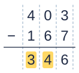

想画出孩子完整的错误过程（比如退位点打错了），用直写布局 `\shushi*{…}`，按孩子实际写的逐行记下来。

### 用选项控制风格

```latex
\shushi[multiCarry, colorByDigit, carryAt=sw]{538\times26}
\shushi[mode=expanded]{23\times4}
\shushi[padZero=false]{2.5+1.25}
```

<p>
  
  &nbsp;&nbsp;
  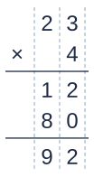
</p>

全部选项见[样式选项](#样式选项)。

## 基本规则

以下是直写布局的写法。

```latex
\shushi*{ 7 4 \\ + 8 8 \\ \hline 1 6 2 }
```

| 规则 | 说明 |
|---|---|
| `\\` 换行 | **分行只能用 `\\`**，直接回车不算换行（KaTeX 会把回车当空格）。为了好读，可以在 `\\` 后面再回车。 |
| 一位一格 | 连续的数字自动拆成一位一格：`74` 和 `7 4` 一样。空格可有可无。 |
| 按个位对齐 | 各行按最右一位（个位）对齐。只要有一行出现小数点，就改为按小数点对齐；小数点写在两个数字中间，不占一格（`pointColumn` 可改成单独占一列）。 |
| 运算符 | 行首的 `+`、`-`、`\times`、`\div`（或 `×`、`÷`）是运算符，不占格子。只能写在一行开头。 |
| `\hline` | 在两行之间画横线，写在 `\\` 之后、下一行之前。 |
| `~` 空格子 | 占一格但不显示，用来让一行左移，例如乘法第二个部分积末位空着：`1 2 9 ~`。 |

多行写法（和上面等价）：

```latex
\shushi*{
     7 4 \\
  +  8 8 \\
  \hline
   1 6 2
}
```

## 格子标记

标记写在数字**前面**，作用于花括号里的数字。花括号里有一串数字时，每一位都加上标记：`\tui{40}` 等于 `\tui{4}\tui{0}`。

| 命令 | 英文别名 | 作用 | 画法 |
|---|---|---|---|
| `\tui{4}` | `\borrow{4}` | 退位点 | 数字正上方一个红点 |
| `\bu{0}` | `\pad{0}` | 补的 0 | 红色虚线框 |
| `\hong{1}` | `\hl{1}` | 教学强调 | 红色数字 |
| `\err{3}` | `\err{3}` | 标为错误 | 黄色底色高亮 |
| `\hua{3}` | `\strike{3}` | 划掉 | 一道斜线 |
| `\textcolor{blue}{…}` | — | 着色 | 用 KaTeX 原有命令，花括号里可以是数字，也可以是整个进位行 |

颜色只接受颜色名或 `#` 开头的色值（如 `red`、`#2f6fd6`）。

## 进位

进位单独写一行：`\jin{…}`（英文别名 `\carry{…}`）。里面的写法和普通行一样，按位对齐、空位用 `~`。**每个数字记在“进到的那一列”**。

```latex
\shushi*{ 7 4 \\ + 8 8 \\ \jin{1 1 ~} \\ \hline 1 6 2 }
```

个位 4+8 进 1 到十位，十位 7+8+1 进 1 到百位，所以进位行是 `1 1 ~`（百位 1、十位 1、个位空）。

进位画在哪里，取决于写在哪两行之间：

- 后面紧跟 `\hline`：坐在横线上（下标）。
- 否则：画在下一行的上方（上标）。多位乘法的第二组进位就是这样写的，见下文。

水平位置由 `carryAt` 选项决定：

| `carryAt=s`（默认，课本写法） | `carryAt=sw`（左下） |
|---|---|
|  | 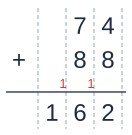 |
| 写在进到的那一列正下方 | 写在产生进位那一位的左下方（贴着两列分界） |

## 各类竖式

### 加法、减法

```latex
\shushi*{ \tui{40} 3 \\ - 1 6 7 \\ \hline 2 3 6 }
```

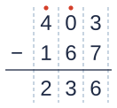

被减数中间有 0 时，被借过的每一位各打一个点，0 上方不另写 9。

### 乘法

两位数乘两位数：第二个部分积用 `~` 左移一位，末位空着。课本默认不写进位。

```latex
\shushi*[operatorPlacement=adjacent]{
      4 3 \\
  \times 3 7 \\ \hline
    3 0 1 \\
  1 2 9 ~ \\ \hline
  1 5 9 1
}
```

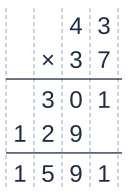

需要写进位时，第一组进位坐在乘数下方的横线上，之后每组写在各自部分积的上方。可以用 `\textcolor` 让乘数的每一位和它的进位、部分积同色：

```latex
\shushi*[carryAt=sw]{
       5 3 8 \\
  \times  2 6 \\
  \textcolor{red}{\jin{2 4 ~}} \\ \hline
  \textcolor{red}{3 2 2 8} \\
  \textcolor{blue}{\jin{1 ~ ~}} \\
  \textcolor{blue}{1 0 7 6 ~} \\ \hline
  1 3 9 8 8
}
```


一位数乘法有简写和分步式两种写法：

| 简写 | 分步式 |
|---|---|
| `2 3 \\ \times 4 \\ \jin{1 ~} \\ \hline 9 2` | `2 3 \\ \times 4 \\ \hline \hong{1} 2 \\ 8 0 \\ \hline 9 2` |
| 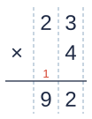 |  |

### 除法

商行用 `\shang` 开头，被除数行用 `\chu{除数}` 开头（自动画括号和顶线），其余每一步照常写。各行按被除数的个位对齐，所以 `4 ~` 让 4 落在十位下面。

```latex
\shushi*{
  \shang 1 7 \\
  \chu{4} 7 1 \\
  4 ~ \\ \hline
  3 1 \\
  2 8 \\ \hline
  3
}
```


### 小数

有小数点时按小数点对齐，小数点默认写在两个数字中间、不占一格；加 `pointColumn` 时单独占一条窄列（课本加减法样本的画法）。位数不够时用 `\bu{0}` 补 0。

```latex
\shushi*[operatorPlacement=adjacent]{ 30.5\bu{0} \\ - 25.21 \\ \hline 5.29 }
```


### 多项式竖式

`\shushi` 的算式里有字母，就按多项式竖式画：每一项整个占一格，各行按同次项对齐，缺项留空位。第一版只做一个字母、整系数。

```latex
\shushi{(x^2+2x-3)(2x+1)}                % 乘法：第二个因式从低次项起每项乘一行，按次数错位再相加
\shushi{(x^3-1)\div(x-1)}                % 长除法：商的每一项写在被除式同次项上方
\shushi[coefficients]{(x^3-1)\div(x-1)}  % 分离系数法：只写系数，缺项写 0
```

<p>
  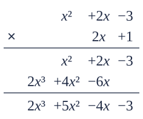
  &nbsp;&nbsp;
  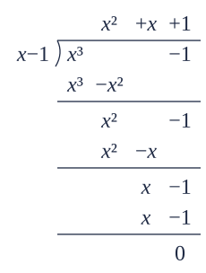
  &nbsp;&nbsp;
  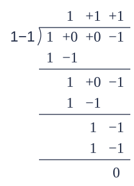
</p>

- 算式写成 `(P)(Q)`、`(P)\times(Q)`、`(P)\div(Q)`；多项要加括号，单项式可以不加（如 `(x^2-1)\times 3x`）。平方写 `x^2`、`x^{2}` 或 `x²`。
- 长除法每步写乘积、横线，减完后把余下的各项都写出来，最后一行是余式（除尽写 0）。商的系数不是整数、被除式次数比除式低、有两个字母、写了答案（`=…`）时报错。以上画法课本里还没核到样本【推论】。
- 不画数位虚线；项排成衬线斜体（与十字相乘一致）。
- 直写用 `&` 分格：每格写一整项，各格从右往左依次是常数项、一次项、二次项……，空着的格是缺项；第一格前面可写 `\shang`、`\chu{除式}`、`\times`，运算符也可以单独占第一格；整项可用 `\err{…}` 等包起来：

```latex
\shushi*{x^2 & +2x & -3 \\ \times & 2x & +1 \\ \hline x^2 & \err{+3x} & -3}
\shushi*{\shang x & +2 \\ \chu{x+1} x^2 & +3x & +2 \\ x^2 & +x & \\ \hline 2x & +2 \\ 2x & +2 \\ \hline 0}
```

### 孩子写错的过程

照孩子实际写的记，用 `\err{}` 标出错的位（这里孩子写成 346，正确是 236，百位和十位错了）。渲染器不校验对错。

```latex
\shushi*{ \tui{4} 0 3 \\ - 1 6 7 \\ \hline \err{34} 6 }
```

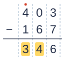

## 样式选项

写在命令后的方括号里，多个选项用逗号分隔；只写名字表示 `true`：

```latex
\shushi*[carryAt=sw, guides=false]{ … }
```

| 选项 | 取值 | 默认 | 作用 |
|---|---|---|---|
| `carryAt` | `s` / `sw` | `s` | 进位写在正下方 / 左下方 |
| `guides` | `true` / `false` | `true` | 数位虚线 |
| `operatorPlacement` | `far` / `adjacent` | `far` | 运算符放最左 / 紧挨数字 |
| `multiCarry` | `true` / `false` | `false` | 多位乘法是否画进位（语义式；直写布局写了 `\jin` 就画） |
| `padZero` | `true` / `false` | `true` | 小数位数不够时补 0，补的 0 加虚线框（语义式） |
| `colorByDigit` | `true` / `false` | `false` | 按乘数位着色，乘数每一位与它的进位、部分积同色（语义式） |
| `mode` | `compact` / `expanded` | `compact` | 一位数乘法：简写 / 分步式（语义式） |
| `strikeZero` | `true` / `false` | `true` | 小数结果末尾的 0 划掉，小数点不划（语义式；孩子写的答案不划） |
| `carry` | `true` / `false` | `true` | 进位总开关（语义式）：关掉后加法、一位数乘都不画进位，多位乘法即使开了 `multiCarry` 也不画 |
| `markPoint` | `true` / `false` | `false` | 小数乘法积的小数点标红（语义式） |
| `markAppended` | `true` / `false` | `false` | 除法添的 0 与对应的商位标红（语义式） |
| `remainder` | `true` / `false` | `false` | 整数除以整数写余数（17……3），默认除成小数（语义式） |
| `pointColumn` | `true` / `false` | `false` | 小数点单独占一列（课本加减法样本的画法）；默认写在两个数字中间、不占一格 |
| `coefficients` | `true` / `false` | `false` | 多项式竖式用分离系数法：只写系数，缺项写 0（语义式） |
| `process` | `auto` / `show` / `hide` | `auto` | 是否画计算过程（语义式）。`auto`：写了孩子答案就不画；`show`：总是画；`hide`：总是不画（出题时只给题目和横线可配合使用） |

接入时也可以统一改默认值，方括号里的选项仍然优先：

```ts
register(katex, { defaults: { carryAt: "sw" } });
```

## 命令一览

| 拼音（主） | 英文别名 | 用途 |
|---|---|---|
| `\shushi*[选项]{…}` | `\vertical*` | 竖式（直写布局） |
| `\shushi[选项]{算式}` | `\vertical` | 竖式（语义式，程序算出过程） |
| `\dengshi[选项]{算式}` | `\stepeq` | 递等式（语义式，按运算顺序逐步化简；选项见“只写前几步”） |
| `\dengshi*[选项]{… \\ …}` | `\stepeq*` | 递等式（直写，每行一步） |
| `\duanchu[result]{数, 数}` | `\shortdiv` | 短除法（语义式：分解质因数、公因数、公倍数） |
| `\duanchu*{除数 \| 数 … \\ …}` | `\shortdiv*` | 短除法（直写） |
| `\shuzhuang[选项]{数}` | `\factortree` | 分解质因数树状图（语义式） |
| `\shuzhuang*[选项]{数 = 因数 \times 因数 \\ …}` | `\factortree*` | 树状图（直写） |
| `\shizi[选项]{二次三项式}` | `\crossmul` | 十字相乘（语义式） |
| `\shizi*{左 & 右 \\ 左 & 右}` | `\crossmul*` | 十字相乘（直写） |
| `\zonghe[result]{(被除式)\div(x-a)}` | `\synthdiv` | 综合除法（语义式） |
| `\zonghe*{根 \| 系数 … \\ & 乘积 … \\ 结果 …}` | `\synthdiv*` | 综合除法（直写） |
| `\jin{…}` | `\carry{…}` | 进位行 |
| `\tui{…}` | `\borrow{…}` | 退位点 |
| `\bu{…}` | `\pad{…}` | 补 0 |
| `\hong{…}` | `\hl{…}` | 红色强调 |
| `\err{…}` | — | 标为错误 |
| `\hua{…}` | `\strike{…}` | 划掉 |
| `\shang` | — | 长除法商行 |
| `\chu{除数}` | — | 长除法被除数行 |

## 注意事项

- **花括号里不能写 `%` 注释**：KaTeX 把它当普通字符交给本库，会报“不认识的字符”。
- **宏会被展开**：KaTeX 会先展开花括号里的宏。`~` 本身就是这样被展开成 `\nobreakspace` 的，本库已经处理；如果你自定义了和本库命令同名的宏（如 `\jin`），会被你的宏替换掉。
- **多字符的格子**（如初中多项式竖式里的 `3x^2`）属于第三期，写 `&` 会提示“暂不支持”。
- 本库依赖 KaTeX 的内部扩展接口，目前锁定在 KaTeX `~0.19.1`。

## 常见报错

| 报错 | 原因 |
|---|---|
| 运算符 + 只能写在一行的开头 | 运算符写在了数字中间，比如 `7 + 4`。 |
| \hline 要单独放在两行之间 | `\hline` 写在了一行末尾，比如 `7 4 \hline`。应写成 `7 4 \\ \hline`。 |
| 花括号没有配对 | 少了 `}`。 |
| 不认识的命令 \xxx | 命令名写错了，或用了还不支持的命令。 |
| 一行里出现了两个小数点 | 比如 `1.2.3`。 |
| 进位行（\jin）里不能有运算符 | 进位行里只能有数字和 `~`。 |
| 竖式里至少要有一行数字 | 只写了横线或进位行。 |
| 这里应该是数字 / 运算符 | 语义式的算式写错了，比如 `\shushi{7+}`，或把直写布局的内容写进了 `\shushi{…}`（直写布局要加星号 `\shushi*`）。 |
| 被减数比减数小 | 语义式减法不处理负数结果。 |
| 除不尽（商是循环小数）暂不支持 | 比如 `7\div3`；要写余数加 `remainder`。 |
| 小数除法的答案不写余数 | 比如 `15.6\div6=2……3.6`。 |
| 除数不能是 0 | — |
| 除不尽；要写近似值或循环小数，请用直写 \dengshi* | 语义式递等式里的除法要能除尽，比如 `1\div3` 不行。 |
| 得负数（negative=false 时不处理负数） | 加了 `negative=false`，算出了负数。 |
| 负数要加括号 | 负数写在运算符后面，比如 `5\times-2`，应写成 `5\times(-2)`。 |
| 负号后面要跟一个数 | 比如 `-(3+4)`；语义式只认负数，不认“负号加括号”。 |
| 小括号 / 中括号没有配对、多了一个右括号 | 括号写错了。 |
| 系数 … 太大（上限 1000000） | 十字相乘的系数超过一百万。 |
| 次数 … 太大（最高 20 次） | 多项式竖式的次数超过 20。 |
| \chu{…} 里只能写除式 | 多项式直写的除式里写了数字、字母、`^`、正负号以外的字符。 |

在 KaTeX 里，这些报错和 KaTeX 自己的语法错误一样处理：`throwOnError: false` 时显示为红色错误文字，不会让页面崩掉。

## 导出 MathML

竖式可以导出成标准 MathML（MathML 3 §3.6 小学算术：`mstack`、`mlongdiv`、`mscarries`、`msline`），方便放进其他支持 MathML 的工具。

```ts
import { shushiToMathML, shushiLayoutToMathML } from "@cn-math-notation/core";

shushiToMathML("403-167");                 // 语义式
shushiLayoutToMathML(String.raw`7 4 \\ + 8 8 \\ \hline 1 6 2`);  // 直写布局
shushiToMathML("74+88", "carryAt=sw", undefined, { carries: "above", wrap: false, display: "inline" });
```

| 竖式里的东西 | MathML |
|---|---|
| 加减乘竖式 | `<mstack stackalign="right">`，每行 `<msrow>`，运算符是行首的 `<mo>` |
| 除法 | `<mlongdiv longdivstyle="lefttop">`（除数在左、商在上） |
| 横线 | `<msline/>` |
| 进位、退位点 | 该行前面的 `<mscarries>`。坐在横线上的进位（课本写法）用 `location="s"` 挂在上一行，没有进位的格子放透明占位（`aria-hidden`）；写在下一行上方的进位、退位点用 `location="n"`，退位点内容是“·” |
| 补的 0 / 划掉的 0 | `<menclose notation="box">` / `<menclose notation="updiagonalstrike">` |
| 错误位、着色 | `mathbackground` / `mathcolor` |
| 数位虚线 | 无对应写法，省略 |
| 朗读文字 | `<math alttext="…">` |

选项（第四个参数）：

| 选项 | 取值 | 默认 | 说明 |
|---|---|---|---|
| `wrap` | `true` / `false` | `true` | 外面包不包 `<math>` |
| `display` | `block` / `inline` | `block` | `<math display>` |
| `carries` | `textbook` / `above` | `textbook` | 进位写法。`textbook`：按课本，坐在横线上的进位画在上一行下方（`location="s"`）；`above`：一律写在进到的那一行上方（`location="n"`，MathML 的默认写法）。 |

**兼容性**：主流浏览器不原生渲染 `mstack` / `mlongdiv`（它们不在 MathML Core 里）。用 W3C 官方 polyfill（elem-math）实测，两种写法的 30 个例子位置都正确。为适配 polyfill 做了三处处理：只用 `s` 和 `n` 两种方位（`se`、`ne` 会错位，左下进位写法在 MathML 里不区分）；坐在横线上的进位铺满整行透明占位（polyfill 用每格的下边框拼横线，带进位的格子会变高，不铺满横线就断成几截）；占位用与真进位同结构的透明数字（`mphantom` 会矮约 1px）。处理后横线下各格高度差 < 0.5px；进位下沿略压横线，是 polyfill 的进位样式（60% 字号、90% 行高）所致。运行 `bun run mathml:preview` 可生成对照页 `out/mathml-preview.html`。

在 KaTeX 里，竖式输出中隐藏的 MathML 默认就是上面的 `mstack` 结构（供复制、辅助技术使用）；`register(katex, { mathml: "label" })` 改为只放朗读文字，`register(katex, { mathmlCarries: "above" })` 让进位写在上方。试写页勾上“显示‘复制 MathML’按钮”后，每个竖式下方会出现复制按钮（默认不显示）。

## 接入方式

### 网页里用 KaTeX

```ts
import katex from "katex";
import "katex/dist/katex.min.css";
import { register } from "@cn-math-notation/katex";

register(katex);
katex.render(String.raw`\shushi*{ 7 4 \\ + 8 8 \\ \hline 1 6 2 }`, element, { displayMode: true });
```

普通公式和竖式可以写在同一个公式里：`74+88=162 \quad \shushi*{…}`。

### 服务端渲染

`katex.renderToString(...)` 的输出里已经包含竖式的 SVG，页面上只需要引入 KaTeX 的 CSS。

### 不用 KaTeX

```ts
import { renderShushiLayout } from "@cn-math-notation/core";

const { svg, label, widthEm, heightEm } = renderShushiLayout(String.raw`7 4 \\ + 8 8 \\ \hline 1 6 2`);
```

- `svg`：SVG 字符串，颜色跟随外层文字颜色（`currentColor`），尺寸以 `em` 计、随字号缩放。
- `label`：朗读用的文字描述。
- 嵌进别的排版盒子时，传 `{ display: "block" }` 作为第四个参数，避免基线错位撑出空白。

### Typora

安装 [Typora 插件](../packages/typora/README.md)后，本库命令**单独写成一个公式**即可：

```latex
$$\shushi{403-167}$$
```

行内公式 `$\shushi{74+88}$` 也可以。和普通公式写在同一个公式里（如 `74+88=162 \quad \shushi{…}`）暂不支持，会提示“本库命令要单独写成一个公式”。

### Obsidian、GitHub、微信、Word 等

这些工具自带公式引擎或不支持公式，无法注册新命令，`\shushi*` 会显示为错误。可以用[出图服务](../packages/server/README.md)生成图片：

```markdown

```

### 给其他公式引擎写插件

不能注册新命令的公式引擎（如 MathJax），可以在交给引擎之前先用 core 判断整个公式是不是本库命令：

```ts
import { translateFormula } from "@cn-math-notation/core";

const r = translateFormula(String.raw`\shushi{403-167}`);
// r.kind："svg"（本库画好的 r.rendered）、"tex"（递等式转成的 TeX，交给引擎）、"pass"（普通公式）、"error"（r.message）
```

本库命令要单独写成一个公式；和其他公式混写时返回 `error`。`translateFormulaMathML` 用于“复制为 MathML”。Typora 插件和出图服务都用这一套。
