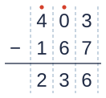
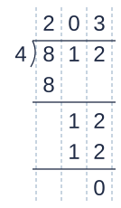

# @cn-math-notation/core

中国中小学数学写法库的核心：把竖式写成几行文字，渲染成和课本一样的 SVG。**不依赖 KaTeX**，可以单独使用，也可以给其他编辑器写插件。

 

```bash
npm install @cn-math-notation/core
```

```ts
import { renderShushi, renderShushiLayout } from "@cn-math-notation/core";

// 语义式：只写算式，程序按课本步骤算出竖式
const { svg, label } = renderShushi("403-167");

// 直写布局：逐行写出，写什么画什么（例如孩子写错的过程）
const layout = renderShushiLayout(String.raw`\tui{4} 0 3 \\ - 1 6 7 \\ \hline \err{34} 6`);
```

- `svg`：SVG 字符串，颜色跟随外层文字（`currentColor`），尺寸以 em 计。
- `label`：给屏幕阅读器的文字描述。

竖式导出 MathML（`mstack` / `mlongdiv`）：`shushiToMathML("403-167")`、`shushiLayoutToMathML(…)`。

递等式（脱式计算）返回 TeX，交给 KaTeX、MathJax 等任何 TeX 渲染器：

```ts
import { buildDengshi, dengshiSteps } from "@cn-math-notation/core";

dengshiSteps("25×(40+4)"); // ["25\\times (40+4)", "25\\times 44", "1100"]
buildDengshi("25×(40+4)"); // "\\begin{aligned}&25\\times (40+4)\\\\[6pt]={}&…\\end{aligned}"
```

在网页里配合 KaTeX 使用，请用 [@cn-math-notation/katex](https://www.npmjs.com/package/@cn-math-notation/katex)。

完整写法、样式选项与例子见 [GitHub](https://github.com/n7tequila/cn-math-notation) 与[使用说明](https://github.com/n7tequila/cn-math-notation/blob/main/docs/usage.md)。

许可：MIT
