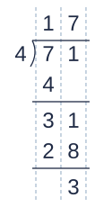

# @cn-math-notation/katex

[KaTeX](https://katex.org) 插件：注册 `\shushi`（竖式）、`\dengshi`（递等式）、`\duanchu`（短除法）、`\shuzhuang`（树状图）与 `\shizi`（十字相乘）命令，在公式里画出和中国课本一样的竖式和递等式。普通公式照常由 KaTeX 排版。

 

```bash
npm install katex @cn-math-notation/katex
```

```ts
import katex from "katex";
import "katex/dist/katex.min.css";
import { register } from "@cn-math-notation/katex";

register(katex);
katex.render(String.raw`\shushi{403-167}`, element, { displayMode: true });
```

| 写法 | 作用 |
|---|---|
| `\shushi{403-167}` | 语义式：只写算式，程序算出竖式（加减乘除，含小数） |
| `\shushi{403-167=346}` | 写上孩子的答案，标出错的位 |
| `\shushi*{ 7 4 \\ + 8 8 \\ \jin{1 1 ~} \\ \hline 1 6 2 }` | 直写布局：逐行写，写什么画什么 |
| `\shushi[carryAt=sw, multiCarry]{538\times26}` | 方括号里写样式选项 |
| `\dengshi{[100-(20+30)]\div5}` | 递等式：按运算顺序逐步化简，等号悬在左边 |
| `\dengshi*{25\times(40+4) \\ 25\times44 \\ 1100}` | 递等式直写：每行一步 |
| `\duanchu[result]{36, 48}` | 短除法：分解质因数、两三个数的公因数与公倍数（`\duanchu*{2 \| 36 48 \\ …}` 直写） |
| `\shuzhuang{36}` | 分解质因数树状图（`split=half` 对半拆；`\shuzhuang*{36 = 4 \times 9 \\ …}` 直写） |
| `\shizi{x^2+5x+6}` | 十字相乘（`[result]` 写分解结果；`\shizi*{x & +2 \\ x & +3}` 直写） |
| `\dengshi[steps=1]{2\times3\times4+1}` | 只写前 1 步，其余留空等号行（`rest=cut` 直接截断） |

英文别名：`\vertical`、`\vertical*`、`\stepeq`、`\stepeq*`。统一修改默认样式：`register(katex, { defaults: { carryAt: "sw" } })`。

- 依赖 KaTeX 的内部扩展接口，目前锁定 KaTeX `~0.19.1`。
- 只在能控制 KaTeX 加载代码的页面生效；Typora、Obsidian、GitHub 等自带公式引擎的工具无法使用。

完整写法见 [GitHub](https://github.com/n7tequila/cn-math-notation) 与[使用说明](https://github.com/n7tequila/cn-math-notation/blob/main/docs/usage.md)。

许可：MIT
