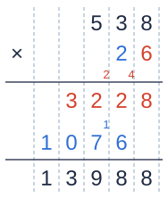

# @cn-math-notation/katex

[KaTeX](https://katex.org) 插件：注册 `\shushi`（竖式）命令，在公式里画出和中国课本一样的竖式。普通公式照常由 KaTeX 排版。

 

```bash
npm install katex @cn-math-notation/katex
```

```ts
import katex from "katex";
import "katex/dist/katex.min.css";
import { register } from "@cn-math-notation/katex";

register(katex);
katex.render(String.raw`\shushi{403-167}`, element, { displayMode: true });
```

| 写法 | 作用 |
|---|---|
| `\shushi{403-167}` | 语义式：只写算式，程序算出竖式（加减乘除，含小数加减） |
| `\shushi{403-167=346}` | 写上孩子的答案，标出错的位 |
| `\shushi*{ 7 4 \\ + 8 8 \\ \jin{1 1 ~} \\ \hline 1 6 2 }` | 直写布局：逐行写，写什么画什么 |
| `\shushi[carryAt=sw, multiCarry]{538\times26}` | 方括号里写样式选项 |

英文别名：`\vertical`、`\vertical*`。统一修改默认样式：`register(katex, { defaults: { carryAt: "sw" } })`。

- 依赖 KaTeX 的内部扩展接口，目前锁定 KaTeX `~0.19.1`。
- 只在能控制 KaTeX 加载代码的页面生效；Typora、Obsidian、GitHub 等自带公式引擎的工具无法使用。

完整写法见 [GitHub](https://github.com/n7tequila/cn-math-notation) 与[使用说明](https://github.com/n7tequila/cn-math-notation/blob/main/docs/usage.md)。

许可：MIT
